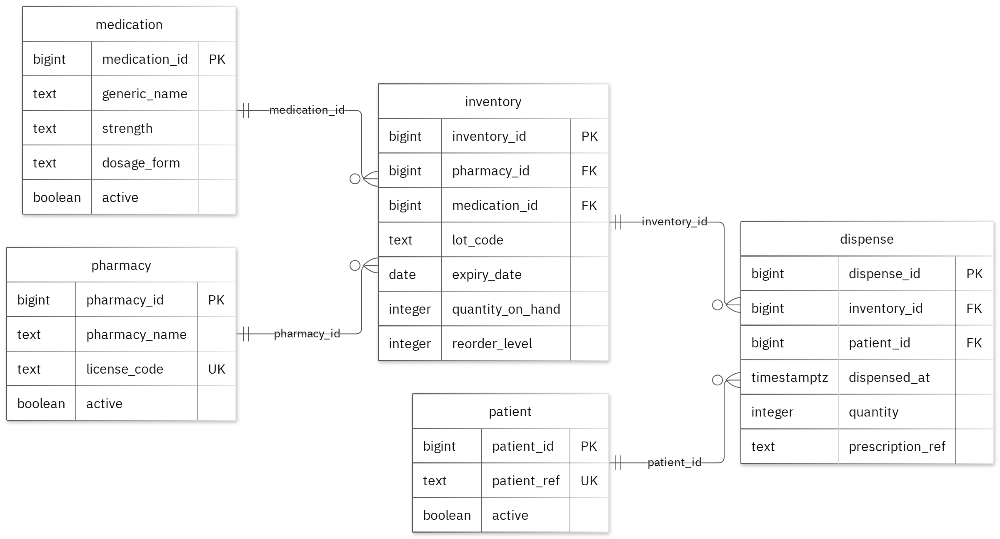

# MIT 8103 Advanced Database Systems

**Pharmacy Inventory & Dispensing System** · Mohammed Jimoh · Student ID 301924534

## Case study

The Pharmacy Inventory & Dispensing System is a database solution built for pharmacy staff, pharmacists, and database students. Structuring data across Medication, Pharmacy, Inventory, Patient, and Dispense tables, the system supports complete lot-level stock tracking, automated low-stock and expiry monitoring, and detailed dispensing logs and quantity summaries.

## Portfolio 1: Database Design and Modelling

The database is built around five main tables that connect using primary and foreign keys to keep everything consistent. I added rules at the schema level to enforce business logic, like making sure stock quantities can't be negative. I also included normalization examples showing how the data moves from 1NF up to 3NF. To make sure the constraints actually worked, I ran 16 invalid insert tests—every single one was blocked, keeping the valid rows completely intact.

Figure 1. Tables, keys and relationships. PK: primary key; FK: foreign key; UK: unique value.

<!-- PAGE BREAK -->

## Portfolio 2: Query Processing and Optimisation

To validate the design, I executed three test queries against the sample data. The multi-table join returned two records, correctly matching lot LOT-AMX-01 with amoxicillin. To evaluate indexing performance under scale, I benchmarked the schema using a synthetic dataset of 50,000 rows. Creating the targeted index reduced the median lookup time from 2.229 ms to 0.264 ms—nearly an 88% speedup. The execution plan confirmed the query used the new index, and both indexed and unindexed runs returned identical, accurate results.

## Portfolio 3: Transactions and Concurrency

Validated transaction isolation (READ COMMITTED) and concurrency controls using a temporary inventory counter. Confirmed proper isolation of uncommitted writes and verified ROLLBACK reliability. Solved a lost update condition—where unlocked concurrent increments produced a total of 2—by implementing SELECT FOR UPDATE row locking, which sequenced sessions to reach the correct final count of 3. All original database schema fields remained preserved.

## Portfolio 4: NoSQL and Advanced Data Models

For the document store component, I created a dispense_events collection in MongoDB. I seeded it with four sample events and tested it across four queries—everything came back cleanly as expected. The validation rules did their job too, blocking both an invalid date format and a duplicate event ID. Embedding snapshots allowed me to bundle relevant historical details directly into each event, while keeping the details field flexible for different event schemas. These were just fictional test records to showcase MongoDB; PostgreSQL is still doing the heavy lifting for relational constraints.
## Repository and evidence

https://github.com/mjimoh4534-ctrl/Jimoh_Mohammed_301924534

The portfolio folders contain the SQL and JavaScript, explanations, query plans, result tables and screenshots.

<!-- PAGE BREAK -->

## Portfolio 5: Distributed and Cloud Database Exercise

I proposed deploying a three-member MongoDB replica set spanning separate failure domains to ensure high availability. The design analysis evaluates primary elections, write concern majority acknowledgments, secondary replication lag, and the structural trade-offs of sharding the dispense_events collection. While replication provides fault tolerance and continuous availability, dedicated backup strategies are still required for disaster recovery—with PostgreSQL requiring its own distinct high-availability architecture. Per project guidelines, this evaluation was conducted theoretically without deploying a live replica set or running active failover tests.
## Individual reflection

By normalizing the schema across five core tables—Medication, Pharmacy, Inventory, Patient, and Dispense—I eliminated redundant data storage and streamlined entity management. Data integrity is enforced at the database level through constraint validation, such as ensuring stock quantities on hand cannot fall below zero. Concurrency testing highlighted a classic lost update scenario where two simultaneous sessions read identical initial states before committing their writes; applying row-level locking (SELECT FOR UPDATE) successfully serialized the transactions and preserved both increments. Finally, execution plan analysis demonstrated that identical query output can mask vastly different underlying resource costs, emphasizing the critical role of database indexing.

## AI-use declaration

 Database models, test scripts, and initial descriptions were developed with assistance from GitHub Copilot and an automated portfolio generator. The tool executed the PostgreSQL and MongoDB test cases, validated query results, and generated output screenshots. As the author, I critically evaluated, verified, and refined all deliverables, taking full responsibility for the accuracy and explanations provided in this submission.
## References

- [PostgreSQL: constraints](https://www.postgresql.org/docs/17/ddl-constraints.html)
- [PostgreSQL: EXPLAIN](https://www.postgresql.org/docs/17/using-explain.html)
- [PostgreSQL: isolation](https://www.postgresql.org/docs/17/transaction-iso.html)
- [PostgreSQL: row locks](https://www.postgresql.org/docs/17/explicit-locking.html)
- [MongoDB: data modelling](https://www.mongodb.com/docs/manual/data-modeling/)
- [MongoDB: replication](https://www.mongodb.com/docs/manual/replication/)
- [MongoDB: sharding](https://www.mongodb.com/docs/manual/sharding/)
- [Mermaid: ER diagrams](https://mermaid.js.org/syntax/entityRelationshipDiagram.html)

